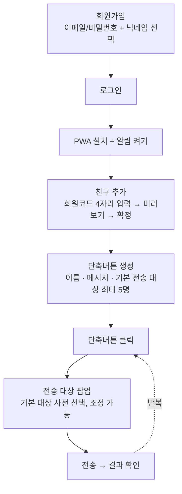

# 렛블블

문자 보내기 귀찮을 때, 미리 만들어둔 단축버튼 하나로 상대에게 푸시알림을 보내는 PWA 웹앱.

## 목차

1. [프로젝트 소개](#프로젝트-소개)
2. [기술 스택 & 선정 기준](#기술-스택--선정-기준)
3. [기능 흐름도](#기능-흐름도)
4. [시작하기 (개발 환경 세팅)](#시작하기-개발-환경-세팅)
5. [사용법](#사용법)
6. [주요 기능](#주요-기능)
7. [프로젝트 구조](#프로젝트-구조)
8. [알려진 제약 / 다음에 고려할 것](#알려진-제약--다음에-고려할-것)

## 프로젝트 소개

친한 사람끼리 "9층 가자", "스모킹 타임", "밥 먹으러 내려가자" 같은 정형화된 안부를 매번 타이핑해서 보내기는 귀찮습니다.
**렛블블**은 자주 쓰는 문구를 "단축버튼"으로 미리 등록해두고, 버튼 한 번 누르면 상대 휴대폰에
푸시 알림으로 바로 전달하는 앱입니다.

- 로그인 기반 **PWA**로, 앱스토어 설치 없이 홈 화면에 추가해서 사용합니다.
- 불특정 다수가 아니라 **4자리 회원코드**로 서로를 등록한 소규모 지인 그룹을 전제로 설계했습니다.
- 메시지에 `{{me}}`(보내는 사람 닉네임), `{{user}}`(받는 사람 닉네임)를 넣으면 수신자별로 자동 치환됩니다.

## 기술 스택 & 선정 기준

| 스택 | 선정 이유 |
| --- | --- |
| **Next.js 16** (App Router, API Routes, Turbopack) | 프론트엔드와 API를 한 저장소·한 배포 파이프라인으로 묶어서 개발 속도를 최적화. Vercel과 조합이 표준화되어 있어 인프라 구축 비용이 거의 없음 |
| **React 19 + TypeScript** | 화면을 컴포넌트 단위로 재사용하고, `src/types/database.ts` / `src/types/app.ts`의 타입으로 DB 스키마·API 응답 계약을 코드 레벨에서 강제해 프론트-백엔드 불일치를 방지 |
| **Supabase** (Auth + Postgres + RLS) | 자체 인증 서버·세션 관리를 새로 만들지 않고 이메일/비밀번호 인증을 바로 사용. Postgres **Row Level Security**로 "내 친구 목록만 조회 가능" 같은 접근 제어를 DB 레벨에서 강제해 API 코드가 단순해짐. 무료 티어로 소규모 지인 서비스 규모에 충분 |
| **web-push (VAPID) + Service Worker** | 네이티브 앱·앱스토어 심사 없이 브라우저 표준만으로 백그라운드 푸시 알림 구현. iOS 16.4+ / Android / 데스크톱 Chrome을 모두 지원해 별도 앱 배포가 필요 없음 |
| **Tailwind CSS v4** | 별도 디자인 시스템 없이 유틸리티 클래스만으로 빠르게 화면을 완성. 소규모·1인 개발 속도에 최적화 |
| **Vercel** | Next.js 제작사의 배포 플랫폼이라 설정 없이 HTTPS + 서버리스 함수 배포가 바로 됨. 웹푸시/PWA는 HTTPS가 필수 조건이라 궁합이 좋음 |

### 왜 NestJS가 아닌 Next.js인가

백엔드만 따로 떼면 NestJS(모듈/DI/데코레이터 기반)도 고려할 수 있었지만, 이 프로젝트 규모에는 과했습니다.

- **API가 단순한 CRUD + 푸시 발송 수준**: `src/app/api/**`의 Route Handler 10여 개 정도로, NestJS의 모듈/컨트롤러/프로바이더 계층 구조나 DI 컨테이너가 주는 이점(대규모 팀 협업, 도메인 경계 분리)을 살릴 일이 없음
- **인증·권한 로직을 대부분 Supabase RLS에 위임**: 컨트롤러 앞단에 Guard/Interceptor를 겹겹이 쌓기보다, DB 레벨에서 "내 것만 보인다"를 강제하는 쪽이 훨씬 코드가 적음
- **프론트/백엔드 배포를 분리할 이유가 없음**: 사용자도, 트래픽도 적은 지인용 앱이라 별도 Nest 서버 + 별도 인프라(도커/PM2/헬스체크 등)를 운영하는 비용이 얻는 이점보다 큼
- **정적 자산(PWA manifest, Service Worker) 서빙까지 한 배포로 처리**: Next.js는 프론트·API·정적 파일을 한 번에 Vercel에 올리면 끝. Nest를 쓰면 프론트(Next/Vite 등)와 백엔드를 각각 배포해야 해서 이 앱 규모엔 배보다 배꼽이 커짐

즉, "타입 안정성 있는 API가 필요하다"는 요구는 NestJS 없이도 TypeScript + 타입 정의(`src/types/`)로 충분히 채워지고, NestJS가 강점을 갖는 지점(대규모 모듈화, 마이크로서비스, 복잡한 DI)은 이 프로젝트에 해당하지 않아 더 가벼운 Next.js API Routes를 선택했습니다.

## 기능 흐름도

### 사용자 여정



### 전송 요청 처리 (`POST /api/push/send`)

```mermaid
flowchart TD
    A[단축버튼 클릭 → 전송 요청] --> B{쿨다운 30초 지남?}
    B -- 아니오 --> B1[429 응답: 남은 시간 안내]
    B -- 예 --> C{선택한 대상이<br/>내 친구 목록에 있음?}
    C -- 아니오 --> C1[400 에러]
    C -- 예 --> D[수신자별 반복 처리]
    D --> E{나를 뮤트했나?}
    E -- 예 --> E1[status: muted]
    E -- 아니오 --> F{수신자 방해금지<br/>시간대인가?}
    F -- 예 --> F1[status: dnd]
    F -- 아니오 --> G{푸시 구독 있음?}
    G -- 아니오 --> G1[status: no_subscription]
    G -- 예 --> H[메시지 템플릿 렌더링<br/>{{me}} / {{user}} 치환]
    H --> I[web-push로 발송]
    I --> J[status: sent / failed]
    E1 & F1 & G1 & J --> K[send_logs 기록 +<br/>단축버튼 last_sent_at 갱신]
    K --> L[결과를 화면에 표시]
```

## 시작하기 (개발 환경 세팅)

### 1. Supabase 프로젝트 준비

1. [supabase.com](https://supabase.com)에서 새 프로젝트 생성
2. `supabase/migrations/0001_init.sql` 내용을 SQL Editor에 그대로 붙여넣고 실행
   - profiles(닉네임/회원코드), friends, shortcuts, shortcut_recipients, push_subscriptions, mutes, dnd_settings, send_logs 테이블과 RLS 정책이 생성됩니다.
3. **Authentication → Providers → Email**에서 **"Confirm email"을 꺼주세요.** (이메일 인증 없이 가입 즉시 로그인되도록 하기 위함)
4. **Project Settings → API**에서 `Project URL`, `anon public` 키, `service_role` 키를 복사

### 2. 환경 변수 설정

`.env.local` (로컬 개발용, 커밋되지 않음)에 아래 값을 채워주세요:

```
NEXT_PUBLIC_SUPABASE_URL=
NEXT_PUBLIC_SUPABASE_ANON_KEY=
SUPABASE_SERVICE_ROLE_KEY=
```

VAPID 키(웹푸시용)는 이미 개발용 키가 채워져 있습니다. 실제 운영 시에는 아래 명령으로 새로 발급받아 교체하는 걸 권장합니다:

```bash
npx web-push generate-vapid-keys
```

### 3. 로컬 실행

```bash
npm install
npm run dev
```

[http://localhost:3000](http://localhost:3000) 접속. 웹푸시는 `localhost`에서도 동작하지만, 실제 배포 도메인(HTTPS)에서 최종 확인하는 걸 권장합니다.

### 4. Vercel 배포

1. GitHub에 push 후 Vercel에서 이 저장소 import
2. Vercel 프로젝트 설정 → Environment Variables에 위 6개 값(`NEXT_PUBLIC_SUPABASE_URL`, `NEXT_PUBLIC_SUPABASE_ANON_KEY`, `SUPABASE_SERVICE_ROLE_KEY`, `NEXT_PUBLIC_VAPID_PUBLIC_KEY`, `VAPID_PRIVATE_KEY`, `VAPID_SUBJECT`) 등록
3. Deploy

## 사용법

### 1. 회원가입 / 로그인

- 이메일, 비밀번호(6자 이상), 닉네임(선택)을 입력해 가입합니다. 닉네임을 비워두면 `블블이00` 형식으로 자동 부여됩니다.
- 가입과 동시에 다른 사람이 나를 찾을 때 쓰는 **4자리 회원코드**가 자동 발급됩니다. (비밀번호 재설정 기능은 없습니다.)
- 가입 후에는 자동 로그인되지 않고 로그인 탭으로 이동합니다. 직접 로그인해주세요.

### 2. PWA 설치 & 알림 켜기 (필수)

푸시 알림을 받으려면 앱을 홈 화면에 설치하고 알림 권한을 허용해야 합니다.

- **iPhone (Safari)**: 공유 버튼 → "홈 화면에 추가" → 홈 화면 아이콘으로 실행 → 로그인 후 "알림 켜기" 버튼 탭
- **Android / 데스크톱 (Chrome)**: 웹앱 접속 후 바로 "알림 켜기" 버튼 탭 (홈 화면 추가는 선택 사항)

### 3. 친구 추가

1. 상대방에게 본인의 4자리 회원코드를 알려달라고 요청
2. "친구" 탭에서 회원코드 입력 → 닉네임 미리보기 확인 → 추가 확정

### 4. 단축버튼 만들기

- 이름, 메시지 내용은 필수입니다.
- 메시지에 `{{me}}`(내 닉네임), `{{user}}`(받는 사람 닉네임)를 넣으면 작성 중 실시간 미리보기로 치환 결과를 볼 수 있습니다.
- 이 버튼을 눌렀을 때 기본으로 선택될 전송 대상을 친구 목록에서 최대 5명까지 지정할 수 있습니다.

### 5. 전송하기

1. 홈 화면에서 단축버튼을 클릭
2. 기본 전송 대상이 미리 선택된 팝업이 뜨고, 대상을 해제/변경 가능 (최대 5명)
3. 전송 확정 → 각 수신자별 발송 결과(성공 / 뮤트됨 / 방해금지 시간 / 실패 / 미구독)를 화면에서 확인
4. 같은 버튼은 **30초 쿨다운** 후 다시 보낼 수 있습니다.

### 6. 설정

- **닉네임 변경**: 설정 탭에서 언제든 변경 가능
- **상대별 뮤트**: 특정 친구에게 알림을 받고 싶지 않을 때, 친구 목록에서 뮤트 설정 (내가 상대를 뮤트하면 상대가 나에게 보내는 알림이 차단됨)
- **방해금지 시간대**: 시작/종료 시각과 타임존을 지정하면 해당 시간에는 어떤 단축버튼을 받아도 알림이 가지 않음 (자정을 넘기는 구간도 지원)

## 주요 기능

- 이메일/비밀번호 회원가입, 가입과 동시에 4자리 회원코드 발급 (비밀번호 재설정 없음)
- 단축버튼 추가/수정/삭제 (이름·메시지 필수, 기본 전송 대상 최대 5명 선택)
- 메시지에 `{{me}}`(보내는 사람 닉네임), `{{user}}`(받는 사람 닉네임) 치환 지원 + 작성 중 실시간 미리보기
- 회원코드로 친구 추가, 추가 전 상대 프로필 미리보기
- 단축버튼 클릭 → 친구 팝업(기본 대상 사전 선택, 최대 5명, 해제 가능) → 전송
- 버튼당 30초 발송 쿨다운
- 상대별 알림 끄기(뮤트), 방해금지 시간대 설정

## 프로젝트 구조

```
supabase/migrations/0001_init.sql   DB 스키마 + RLS
src/middleware.ts → src/proxy.ts    인증 라우트 보호 (Next.js 16 proxy 컨벤션)
src/lib/supabase/{client,server,admin}.ts   Supabase 클라이언트 (브라우저/서버/서비스롤)
src/lib/push/webpush.ts             웹푸시 발송
src/lib/utils/{message,dnd,push-client}.ts  메시지 템플릿, 방해금지 판정, 구독 유틸
src/app/login                       회원가입/로그인
src/app/(main)                      홈 / 친구 / 설정 (공통 상단 네비게이션)
src/app/api/**                      REST API Route Handlers
public/manifest.json, public/sw.js  PWA 매니페스트 & 서비스워커
```

## 알려진 제약 / 다음에 고려할 것

- 회원코드가 4자리 숫자라 전수조사로 다른 사람 코드를 알아낼 수 있습니다. 지인 소규모 사용을 전제로 한 트레이드오프입니다.
- 발송 결과(성공/뮤트/방해금지/실패/미구독)는 보내는 화면에서만 확인 가능하고, 별도의 인앱 알림함은 없습니다.
- 아이콘은 자리표시용 단색 PNG입니다. `public/icons/`, `public/favicon-32.png`를 원하는 디자인으로 교체하세요.
